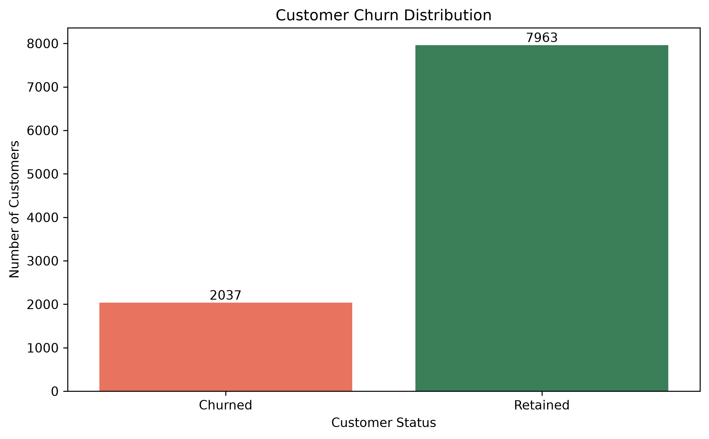
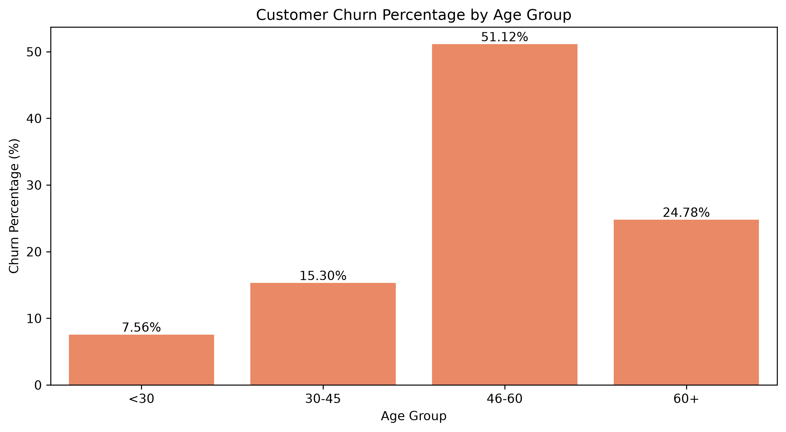
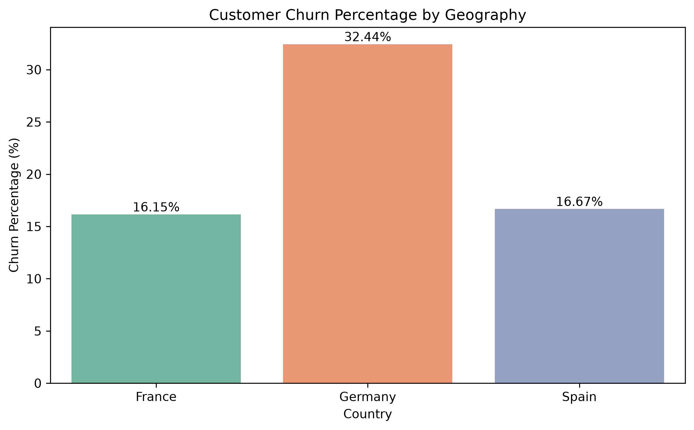
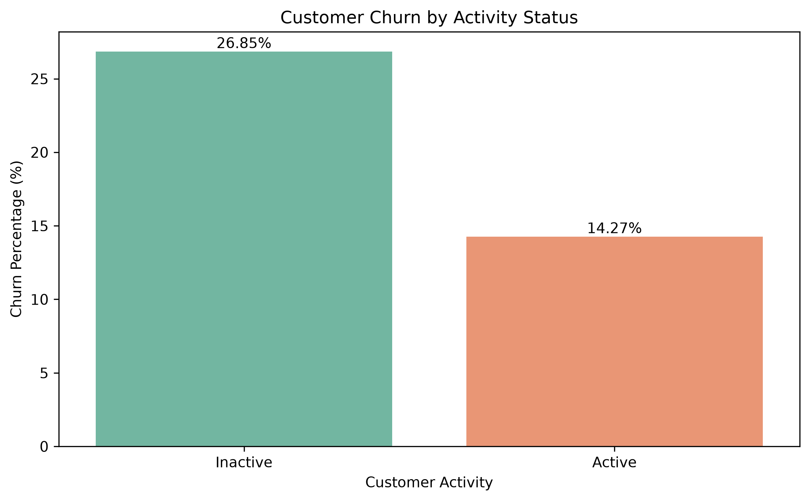
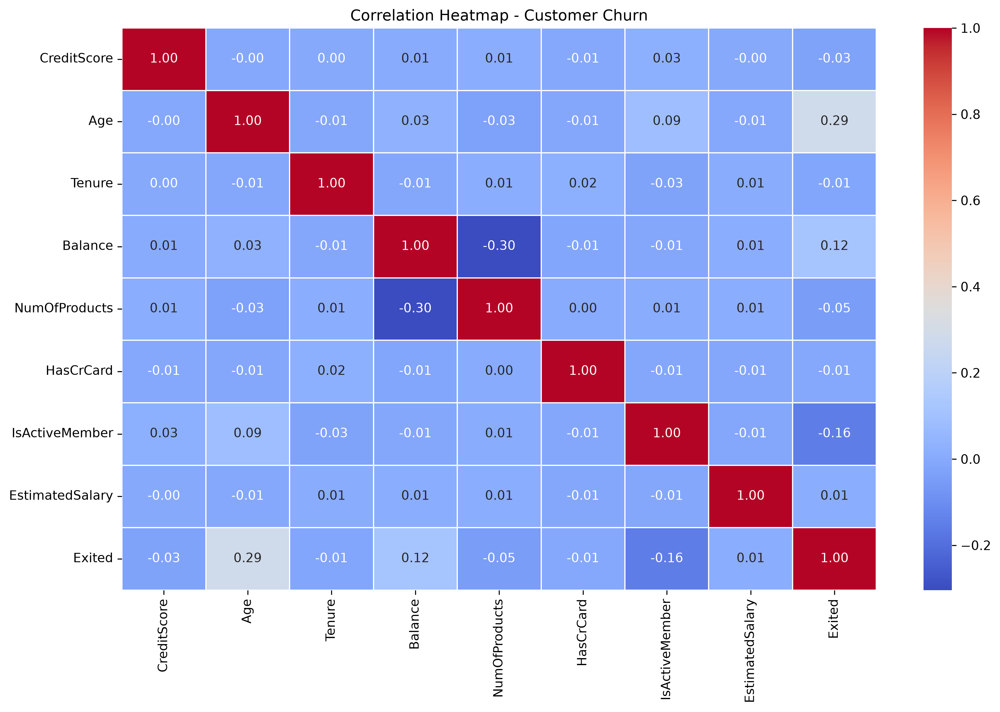

# Customer Segmentation & Churn Pattern Analytics in European Banking

## Project Introduction

I worked on this project to understand why customers leave a bank and what customer details might be related to their decision to leave.

For this, I used a European bank customer dataset containing 10,000 records. I explored the data, grouped customers based on different details and checked their churn percentages.

## Dataset Information

- Dataset: European_Bank.csv
- Total customer records: 10,000
- Original columns: 14
- Dataset source: Unified Mentor

**Note:** The original dataset is not included in this public GitHub repository.

## What I Did in This Project

First, I loaded the dataset using Python and checked the available columns and records. I removed the Surname column because it was not needed for my analysis.

After that, I created different customer groups based on age, credit score, account balance and banking experience.

I then compared customer churn based on:

- Age and gender
- Country
- Customer activity
- Credit score and tenure
- Account balance
- Number of bank products
- Credit card ownership
- Estimated salary

I also checked the correlation between numerical columns and created graphs to understand the results more clearly.

## Results I Found

During the analysis, I found that:

- Out of 10,000 customers, 2,037 had left the bank.
- The overall churn percentage was 20.37%.
- Inactive customers had a higher churn rate than active customers.
- Germany had the highest churn among the three countries.
- Customers with two bank products had a much lower churn rate than customers with one product.
- Age showed a stronger relationship with churn than most of the other numerical columns.

## Graphs and Visualizations

I created different graphs to understand customer churn patterns more clearly.

### 1. Overall Customer Churn

### 2. Churn by Age Group

### 3. Churn by Geography

### 4. Churn by Customer Activity

### 5. Correlation Heatmap

## Tools I Used

- Python
- Pandas
- NumPy
- Matplotlib
- Seaborn
- VS Code

## Project Files

- `data/` – The original dataset was provided by Unified Mentor and is not included in this public repository.
- `notebooks/` – Contains the Python analysis code.
- `reports/graphs/` – Contains the graphs created during the analysis.
- `reports/EDA_Summary.md` – Contains the analysis results and findings.
- `requirements.txt` – Contains the Python libraries required for this project.

## What I Learned

While working on this project, I got practical experience with Python and data analysis. I learned how to clean a dataset, group customers, calculate churn percentages, check correlations and create visualizations.

This project also helped me understand how customer data can be used to find patterns that may help a bank improve customer retention.
